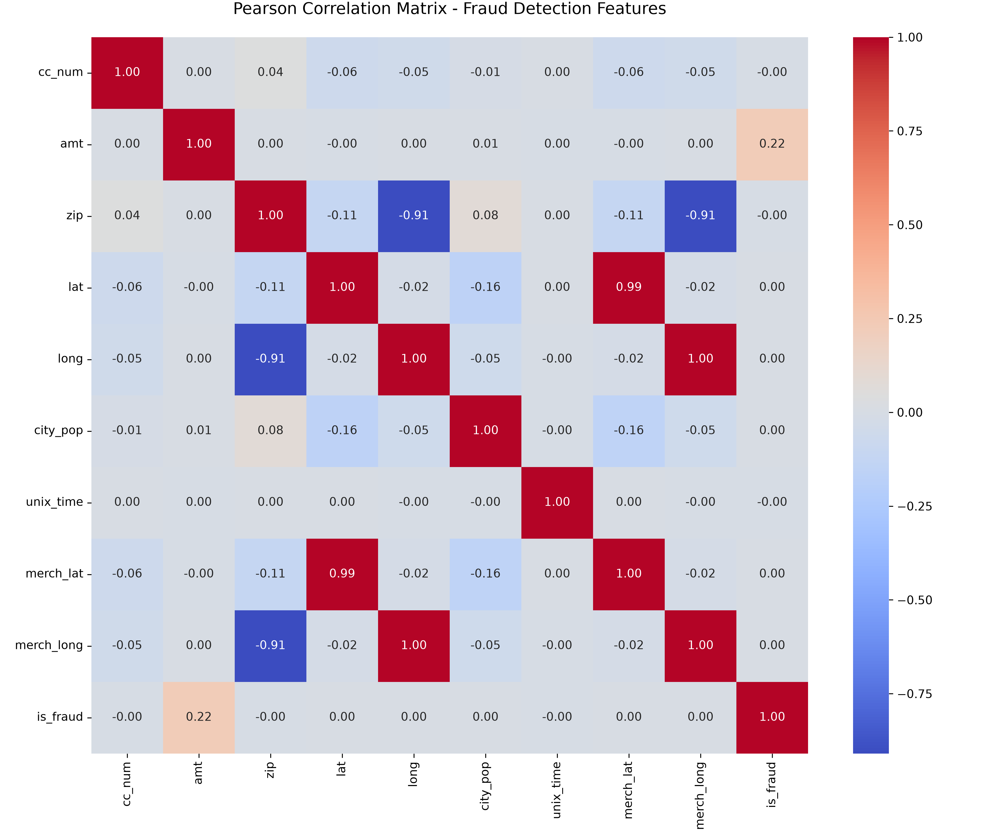

# Audit Anomaly & Fraud Detection Pipeline 💳🔍

[](https://www.python.org/)
[](https://scikit-learn.org/)
[](https://imbalanced-learn.org/)
[](https://sqlite.org/)

## 📌 Executive Summary
This project builds an end-to-end machine learning pipeline to detect fraudulent credit card transactions within a heavily imbalanced dataset (0.17% actual fraud in raw records). Designed for a high-stakes financial audit environment, the system prioritizes **Recall** and **Precision** over deceptive raw accuracy to balance the interception of fraudulent behavior with the mitigation of false alarms for normal customers.

---

## 🏗️ Architecture & Tech Stack
* **Data Extraction:** SQL (SQLite database mimicking enterprise data warehouses).
* **Exploratory Data Analysis (EDA):** Python, Pandas, Seaborn, Matplotlib.
* **Class Imbalance Resampling:** Synthetic Minority Over-sampling Technique (SMOTE).
* **Machine Learning Models:** Logistic Regression, Artificial Neural Network (MLP Classifier).

---

## 📊 Methodology

### 1. Feature Engineering & Correlation
To maintain interpretability in an audit environment, **Pearson Correlation** was utilized over dimensionality reduction techniques:
* **Key Finding:** Transaction `Amount` showed the highest linear correlation with fraud, while geographic coordinates exhibited severe multicollinearity, informing our feature selection.



### 2. Handling Severe Class Imbalance
The training dataset contained over 1.03 million rows, with only a **0.58%** fraud ratio. Training directly on this distribution produces a model with 99% accuracy that catches 0% of fraud.
* **Remediation:** Applied **SMOTE (Synthetic Minority Over-sampling Technique)** strictly to training splits, synthesizing realistic minority-class instances to achieve a balanced 50/50 training distribution while keeping the test set pristine to prevent data leakage.

---

## 🚀 Model Evaluation & Business Impact

Two distinct model architectures were evaluated on **259,335 unseen test transactions**:

| Model | Recall (Fraud Catch Rate) | Precision (False Alarms) | F1-Score |
| :--- | :---: | :---: | :---: |
| **Artificial Neural Network (MLP)** | 0.76 | 0.06 | 0.11 |
| **Logistic Regression** | **0.76** | **0.09** | **0.15** |

### 🏆 Conclusion: The Case for Simplicity
While both models successfully intercepted **76% of actual fraud**, the **Logistic Regression** model is the clear winner for deployment in an audit context:
* **Lower False Positives:** Achieving a 50% higher precision score (0.09 vs. 0.06) drastically reduces false positive card freezes, preventing legitimate customers from facing unnecessary card declines while capturing identical fraud volume.
* **Audit Explainability:** Linear coefficients provide transparent, auditable justification required by financial regulators.

---

## 📁 Repository Structure

```text
audit-fraud-detection/
├── src/
│   ├── database_setup.py      # Ingests raw tabular data into SQLite database
│   ├── correlation.py         # Pearson correlation analysis & heatmap generator
│   ├── balance_data.py        # Applies SMOTE balancing to train split
│   ├── eda_modeling.py        # Exploratory analysis & feature distributions
│   └── train_models.py        # Model training & classification metric reports
├── correlation_heatmap.png    # Exported correlation matrix
├── requirements.txt           # Python dependencies
└── README.md                  # Project documentation
```

---

## ⚙️ Quickstart

```bash
# 1. Clone repository
git clone https://github.com/Downey112/audit-fraud-detection.git
cd audit-fraud-detection

# 2. Set up virtual environment
python -m venv .venv
source .venv/bin/activate  # On Windows: .venv\Scripts\activate
pip install -r requirements.txt

# 3. Run Pipeline
python src/database_setup.py
python src/correlation.py
python src/balance_data.py
python src/train_models.py
```